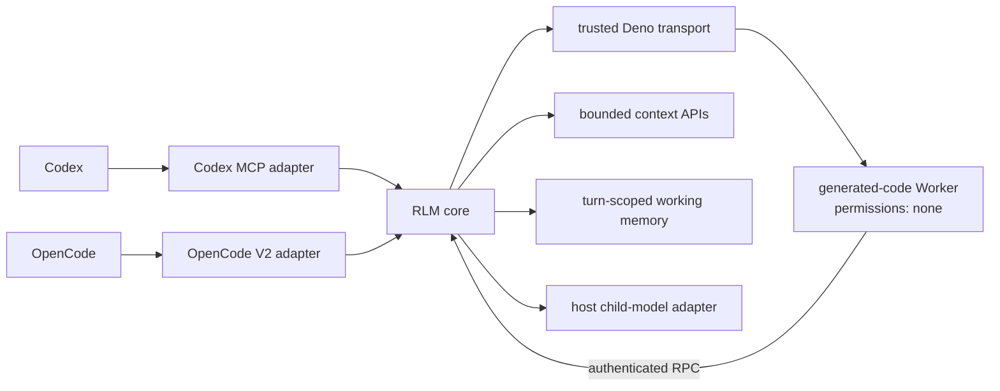

# RLM

**A host-adapted Recursive Language Model runtime for Codex and OpenCode, with a zero-permission generated-code sandbox, bounded repository context, turn-scoped working memory and per-turn budgets.**

[](https://github.com/arttvad9r/RLM/actions/workflows/standalone-ci.yml)
[](https://nodejs.org/)
[](https://deno.com/)
[](#codex)
[](#opencode)
[](LICENSE)

RLM gives a root model three complementary tools: structured `rlm_map` for repository partition/map/merge work, asymmetric `rlm_verify` for conservative false-positive filtering, and raw `rlm_exec` as an escape hatch for custom orchestration. All three use the same bounded context, child scheduler, model-routing policy, budgets and zero-permission generated-code sandbox; raw executions additionally expose bounded turn-scoped working memory.

Working memory stays in the trusted host process rather than the root conversation. It can carry compact intermediate state across multiple `rlm_exec` calls in one user turn, but it is not durable long-term memory: it is cleared when the authoritative user turn changes and evicted when the host reports session deletion.

The core runtime does not depend on a particular agent host. Host-specific code is responsible only for authoritative turn identity and child-model execution.



## Why RLM

Large repository tasks often need two different capabilities at once:

- deterministic code for filtering, grouping, routing and aggregation;
- model calls for semantic work that code cannot do reliably.

RLM combines them behind an explicit authority boundary. Generated orchestration code gets `llm()`, bounded `context.*` APIs and bounded turn-scoped `memory.*` instead of ambient machine access. Large intermediate child results can stay outside the root conversation and be reduced programmatically before the root sees them. The runtime enforces per-execution and per-user-turn budgets and fails closed when turn, workspace or sandbox authority cannot be established.

## Scope and ecosystem

RLM intentionally does not try to replace the official RLM runtime, DSPy, or a full coding agent. Codex/OpenCode remain the outer agent loop; this project supplies a bounded RLM-style computation capability inside that loop.

See [Ecosystem gap analysis](docs/ecosystem-gap-analysis.md) for the comparison with official RLM, DSPy.RLM, Prime Agent and structured RLM research, and [Roadmap](docs/roadmap.md) for the resulting scope decisions and non-goals.

## Install

### Codex

Requirements: Node.js 24+, Deno 2.x, and a working Codex CLI login.

```bash
npm install -g github:arttvad9r/RLM
codex mcp add rlm -- rlm-codex
```

Then start Codex in a project. A minimal smoke request is:

```text
Use rlm_exec exactly once with this code: return { ok: true, value: 42 }.
Return only the tool result.
```

A recursive smoke request is:

```text
Use rlm_exec exactly once with this code:
return await llm("What is 17 * 19? Return only the integer.")
Return only the tool result.
```

The Codex adapter reads authoritative `threadId`, `turn_id`, turn start time, model and workspace from Codex MCP metadata. Child calls use the same model and reasoning effort, run from an empty temporary directory, ignore user/project instructions and user MCP configuration, disable network authority, deny filesystem authority for `/`, disable login-shell authority and do not inherit shell environment variables.

### OpenCode

Requirements: Node.js 24+, Deno 2.x, OpenCode 2.0.29 or a compatible V2 host, and any OpenCode model/provider that works in your installation.

```bash
opencode plugin add github:arttvad9r/RLM
```

Then ask the model to use `rlm_map` for standard repository fan-out, `rlm_verify` for conservative filtering of candidate paths, or `rlm_exec` for custom orchestration. The optional RLM-aware OpenCode agent prompt is in `agent/rlm.md`. OpenCode 2.x Code Mode exposes plugin tools inside its `execute` catalog, so the effective call path is `execute -> tools.rlm_map(...)`, `execute -> tools.rlm_verify(...)`, or `execute -> tools.rlm_exec(...)`; this is expected and does not give generated RLM code access to OpenCode tools.

OpenCode is an adapter, not a dependency of the RLM core. Its child sessions inherit the exact parent provider/model, receive a deny-all permission rule and have their ordinary tool inventory stripped.

## Runtime API

For ordinary repository-wide semantic work, prefer `rlm_map` instead of asking the model to write orchestration JavaScript. It accepts a bounded file query, semantic instruction, optional `fanout` (default 4, maximum 16), partition strategy, failure mode, and deterministic output mode.

Partition strategies:

- `round_robin` — default/backward-compatible deterministic assignment;
- `balanced_chars` — deterministic greedy balancing by source characters for repositories with uneven file sizes.

Failure modes:

- `strict` — default; any child failure rejects the map;
- `settled` — successful partitions survive and failures are returned as bounded `partitionErrors`.

Output modes:

- `text` — one child result per partition (`null` marks a failed partition only in settled mode);
- `path_list` — child JSON path arrays are accepted only for files in the exact partition that child received, then deduplicated and sorted;
- `candidate_bundle` — the same partition-confined paths plus trusted source text and a versioned conservative-verification contract for compact root-side checking.

Every structured result carries `schemaVersion`, partition statistics and failure accounting. Structured child prompts explicitly frame repository files as untrusted data, and an oversized partition fails before any child inference with guidance to increase fanout or narrow the query. Child responses are also hard-bounded before structured parsing: 32,768 characters for `text` and 16,384 characters for `path_list` / `candidate_bundle`. Oversized or malformed structured responses fail deterministically in `strict` mode and become bounded partition errors in `settled` mode; RLM does not launch an automatic repair/retry model call. Candidate source handoff is capped below the generic final-result ceiling so `candidate_bundle` cannot silently turn into a repository-wide context dump.

`rlm_map` compiles the request to a fixed trusted template and then uses the exact same sandbox, context policy, child routing, budgets and telemetry as `rlm_exec`; the host validates the structured result contract again before exposing it to the root. Exact repeated `rlm_map` requests from the same authoritative assistant boundary are suppressed after the first successful completion, so an accidental repeated Code Mode call reuses the completed result instead of launching another semantic fan-out. The replay cache keeps only the latest structured request for at most 64 sessions, is evicted on OpenCode session deletion, and never applies to raw `rlm_exec` because raw code may intentionally mutate working memory. Replayed calls intentionally do not emit provider-usage telemetry a second time.

For a two-stage precision pass, call `rlm_map` with `output=path_list`, then pass at most 64 returned paths to `rlm_verify` with the same positive selection rule. `rlm_verify` re-reads those paths through trusted bounded context authority; the root does not pass source text back into the verifier. Every candidate is presumptively valid. Verification children can only return paths to **remove**, and a removal is accepted only for a path in that child's exact partition. Unknown paths and cross-partition selections are rejected. In `settled` mode, provider failures, malformed JSON and oversized responses preserve every candidate in the affected partition because failed verification is uncertainty, not evidence for removal.

`rlm_verify` uses the same 1–16 fan-out and four-child concurrency ceiling as `rlm_map`; with the existing 32-child per-turn budget, a maximum 16-child scan followed by a maximum 16-child verification pass fits without widening authority. Its path-array child responses are hard-bounded to 16,384 characters before parsing, it performs no automatic repair/retry call, and identical same-boundary verification requests are deduplicated after successful completion.

Generated JavaScript in raw `rlm_exec` runs inside the zero-permission Worker and may use:

```js
const files = await context.files("src/")
const inputs = await context.readMany(files.slice(0, 4))
const summaries = await llm.batch(
  inputs.map((file) => `Summarize this file:\n${file.content}`),
)
await memory.set("analysis:summaries", summaries)
return { files: files.length, stored: summaries.length }
```

A later `rlm_exec` in the same root user turn can continue from that state without returning the bulk data through the root conversation:

```js
const summaries = await memory.get("analysis:summaries")
return { stored: Array.isArray(summaries) ? summaries.length : 0 }
```

Available calls inside raw `rlm_exec` JavaScript:

- `llm(prompt)` — one isolated semantic child call;
- `llm.batch(prompts)` — strict 1–16 child calls; the host schedules at most 4 concurrently, preserves result order and rejects if any child fails;
- `llm.batchSettled(prompts)` — the same scheduling/budgets, but returns per-item success/error objects so successful siblings survive a child failure;
- `context.files(query)` — bounded project-relative path listing;
- `context.read(path)` — bounded exact UTF-8 read;
- `context.readMany(paths)` — up to 64 reads with per-file errors;
- `context.grep(pattern)` — bounded regex search with a host-owned timeout;
- `memory.get(key)` — read a JSON value from the current root turn, or `undefined` when absent;
- `memory.set(key, value)` — store a JSON-serializable value for later `rlm_exec` calls in the same turn;
- `memory.delete(key)` — delete one entry and return whether it existed;
- `memory.keys()` — list stored keys in lexical order.

Current hard limits include 16 child prompts, at most 4 concurrent child calls, 32 context operations and 64 memory operations per `rlm_exec`; 32 child calls, 96 context operations and 128 memory operations per user turn; 1 MiB context output per execution, 2 MiB context output per turn, 128 memory entries, 131,072 serialized JSON characters per stored value, 524,288 key-plus-serialized-value characters total working memory per turn and a 120-second execution timeout. See `plugin/rlm-lib/constants.ts` for the complete limits.

Every successful execution now emits a canonical `telemetry` v1 envelope alongside the existing compatibility metadata. It records adapter/run/turn identity, the exact root model at the authoritative host boundary when available, child success/failure counts and model identities, input/output plus provider-reported cache-read/cache-write token totals, context/memory usage, result size, runtime termination state and explicit exec/turn limits. A bounded `child.invocations` array records each actual child provider call by index with model, status, latency, returned-text character count, token/cache/cost counters and stable provider-call error code; it deliberately excludes prompts, results and child session IDs. Structured map/verify telemetry separately counts format and output-limit violations so a provider call that completed successfully is not mislabeled as a provider failure merely because its structured response was invalid. The canonical envelope intentionally excludes raw prompts, file contents, memory values, credentials and workspace paths.

## Security model

There are three distinct trust zones:

1. **Host adapter** — trusted. It establishes the authoritative workspace/turn and performs child-model calls.
2. **Deno transport** — trusted. It has only the narrow read authority needed to load the fixed generated Worker entry module.
3. **Generated-code Worker** — untrusted. It runs with `permissions: "none"` and communicates through a private transferred `MessagePort` plus an authenticated host protocol.

Model-generated JavaScript never receives filesystem handles. Context reads are performed by trusted host code after lexical and canonical path confinement, hidden-path checks and byte/result limits. `.git` and `.env*` are hidden by default (`.env.example` remains visible).

Working-memory values are held only in trusted host-process memory as bounded serialized JSON. They are keyed by the host-authoritative root session and user turn, are not written to disk by RLM, are never injected into child sessions, and are cleared on turn transition. Memory operations are individually atomic at the host map boundary; multi-step read/modify/write sequences are not transactional.

Child isolation is host-specific:

- **OpenCode:** a real child session with deny-all permissions, a complete explicit tool deny map and a context hook that removes tools and replaces inherited system context with the stateless RLM child prompt.
- **Codex:** a fresh ephemeral `codex exec` process using the parent model. It starts in an empty directory with user config/rules ignored, project docs disabled, filesystem `/` denied, network disabled, login shell disabled and shell environment inheritance disabled. Codex may still expose built-in tool names internally; security relies on the permission profile making filesystem/network authority unavailable, not on claiming those tool objects do not exist.

Turn budgets are tied to host-owned identities rather than caller-provided arguments. OpenCode resolves the exact assistant boundary to its preceding user message. Codex uses MCP `threadId`, `turn_id` and `turn_started_at_unix_ms`.

This is not advertised as an OS-level process/RSS boundary. See [Known limitations](docs/known-limitations.md).

## Context authority

Explicit context authority is host-neutral:

1. `$XDG_CONFIG_HOME/rlm/host.json` when present;
2. `RLM_CONTEXT_ROOT` when no host config exists;
3. the worktree/workspace supplied by the active host;
4. the active host session directory when no broader worktree exists.

`OPENCODE_RLM_CONTEXT_ROOT` remains a deprecated environment alias for compatibility. New integrations should use `RLM_CONTEXT_ROOT`.

A host config can independently narrow context authority and select the semantic child model:

```json
{
  "version": 1,
  "context_root": "/absolute/project/root",
  "context_policy": {
    "allowed_paths": ["src", "docs"],
    "max_read_bytes": 131072,
    "max_grep_matches": 200,
    "max_list_entries": 4096
  },
  "child_model": {
    "strategy": "fixed",
    "provider": "openai",
    "model": "gpt-6-luna",
    "variant": "low"
  }
}
```

All fields except `version` are optional. Without `child_model`, or with `{ "strategy": "inherit" }`, children inherit the exact root model/variant. `fixed` is trusted host configuration rather than a generated-code argument: OpenCode requires an explicit provider, while Codex accepts OpenAI/Codex model names and treats `variant` as reasoning effort. Unsupported fixed-model requests fail closed.

When no host config exists, `RLM_CONTEXT_POLICY` may contain the same `context_policy` object as JSON. `OPENCODE_RLM_CONTEXT_POLICY` is a deprecated compatibility alias. Policy can only narrow compiled hard limits. Filesystem root and the user's HOME are rejected as context roots.

## Repository layout

- `adapters/codex/` — Codex MCP adapter and isolated Codex child launcher.
- `plugin/rlm.ts` — OpenCode V2 entrypoint.
- `plugin/rlm-lib/` — shared runtime/core plus the OpenCode compatibility adapter layer. The host-neutral boundary is `RlmHost` in `host.ts`.
- `plugin/rlm-runner/` — trusted Deno transport and zero-permission generated-code Worker.
- `dist/` — committed JavaScript runtime used by the Codex MCP binary; no install-time build step is required.
- `plugin/tests-host/` — Node-native host/core regressions.
- `plugin/tests/` — Deno runtime/security regressions.
- `benchmarks/` — frozen corpora, ground truth and provider-neutral comparison harness.
- `docs/known-limitations.md` — boundaries that are deliberately not overclaimed.
- `docs/ecosystem-gap-analysis.md` — feature/architecture comparison and product boundary.
- `docs/roadmap.md` — prioritized work and explicit non-goals.

## Development

```bash
npm ci --ignore-scripts
npm test
```

Useful individual gates:

```bash
npm run check:standalone
npm run test:host-runtime
npm run typecheck
npm run test:plugin
npm run test:benchmarks
npm run verify:benchmarks
npm run check:codex-dist
npm run check:package
```

Network-dependent OpenCode provider smokes are available separately and are intentionally not part of `npm test`:

```bash
npm run test:opencode-live
# Use a provider that permits tool-less child sessions for the recursive gate:
npm run test:opencode-live -- --recursive

# Structured map smoke: requires an explicitly selected provider/model.
RLM_LIVE_OPENCODE_MODEL=provider/model[#variant] npm run test:opencode-structured-live

# Structured map -> conservative verify smoke: explicitly selected provider/model.
RLM_LIVE_OPENCODE_MODEL=provider/model[#variant] npm run test:opencode-verify-live
```

The basic live smoke defaults to `opencode/glm-5.3-flash-free`; override it with `RLM_LIVE_OPENCODE_MODEL=provider/model[#variant]`. The structured smokes deliberately have no provider default because they create semantic child sessions and therefore may consume paid quota. The map smoke exercises `rlm_map` with two children. The verify smoke exercises the production `rlm_map(path_list) -> rlm_verify` path on a tiny controlled workspace where one explicit safe exception must be removed and two explicit positives must be retained. Both capture root/child usage before cleanup and remove their temporary plugin snapshot and sessions afterward. The verify smoke is compatibility/mechanics evidence, not a quality benchmark.

`npm test` runs the complete deterministic repository gate. Live provider tests are intentionally separate because they require external authentication and consume model quota. Benchmark runners should capture the OpenCode root/child session tree before deleting sessions; `scripts/lib/opencode-evidence.mjs` provides provider usage/cache/cost capture plus an optional CodeBurn API-equivalent cost cross-check when CodeBurn is installed.

`check:package` creates the installable tarball with lifecycle scripts disabled, verifies required runtime files and installs it into an empty project. `check:codex-dist` verifies that the committed Codex JavaScript artifact matches the TypeScript source.

> **Status:** active experimental runtime. The deterministic sandbox/security/benchmark harness is extensive, but the project does not claim an RLM quality/cost advantage until real model benchmark run records are committed.

## Benchmarks

See [`benchmarks/README.md`](benchmarks/README.md). Ground truth and manifests are benchmark infrastructure and must never be included in the runtime context root used for a benchmark execution.

## Provenance

RLM began as a standalone extraction from `arttvad9r/Opencode-Autopilot`. The current repository keeps that migration record for auditability, but the runtime is no longer architected as an OpenCode-only component.

- Source commit: `f72b1fda78ef03d47a4278d2f16687550d5927fe`
- Migration record: `docs/repository-migration.md`

[Contributing](CONTRIBUTING.md) · [Security policy](SECURITY.md) · [Known limitations](docs/known-limitations.md) · [Ecosystem analysis](docs/ecosystem-gap-analysis.md) · [Roadmap](docs/roadmap.md)
