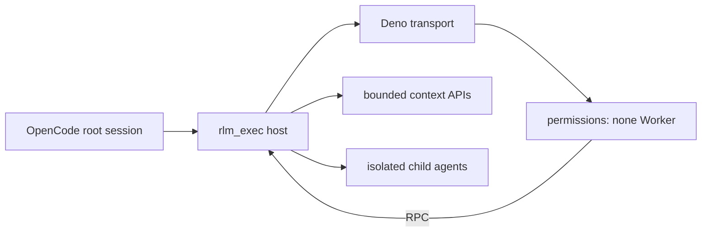

# OpenCode RLM

**A sandboxed Recursive Language Model runtime for OpenCode with bounded context, child-agent delegation and deterministic benchmarks.**

[](https://github.com/arttvad9r/RLM/actions/workflows/standalone-ci.yml)
[](https://nodejs.org/)
[](https://deno.com/)
[](https://www.typescriptlang.org/)
[](LICENSE)

RLM lets a root model delegate semantic work to isolated child sessions and run generated orchestration code without giving that generated code ordinary filesystem, network, environment, subprocess or FFI authority. Host-mediated context APIs, per-turn budgets and an authenticated sandbox protocol keep the execution boundary explicit.



## Why this repository exists

- Keep the RLM runtime independent from a larger scheduler/control-plane project.
- Make context authority and per-turn resource budgets explicit and testable.
- Separate trusted host/transport code from generated orchestration code.
- Provide frozen benchmark corpora and provider-neutral comparison tooling.
- Fail closed when session identity, context scope or sandbox assumptions cannot be proven.

## Install

RLM can be installed directly from GitHub; an npm release is not required:

```bash
opencode plugin add github:arttvad9r/RLM
```

OpenCode accepts Git package specifiers for plugins. The package ships the TypeScript plugin and Deno runner sources directly, so installation does not depend on package lifecycle/build scripts. Deno 2.x must be available on the host `PATH`.

Then start OpenCode in a project and ask the model to use `rlm_exec`. A minimal smoke prompt is:

```text
Use rlm_exec exactly once. Execute: return { ok: true, value: 42 }. Return only the tool result.
```

The optional RLM-aware agent prompt lives at `agent/rlm.md`. It adds routing guidance for large semantic repository tasks; the plugin itself does not require that agent.

## Development quick start

```bash
npm ci --ignore-scripts
npm test
```

`npm test` is the complete standalone gate: coupling check, Node host/runtime regressions, type checks, Deno plugin/security tests, deterministic benchmark verification and a packed-artifact installation check. See `docs/known-limitations.md` before treating the sandbox as an OS-level resource boundary.

> **Status:** active experimental runtime. The security model is intentionally strict, and known hardening limitations are documented rather than hidden. The benchmark harness is ready, but the repository does not claim a quality/cost advantage until real model run records are committed.

[Contributing](CONTRIBUTING.md) · [Security policy](SECURITY.md) · [Known limitations](docs/known-limitations.md)

## Layout

- `agent/rlm.md` — RLM-aware OpenCode agent prompt.
- `plugin/rlm.ts` — plugin entrypoint exposing `rlm_exec`.
- `plugin/rlm-lib/` — host-side child sessions, context policy, protocol, budgets and sandbox lifecycle.
- `plugin/rlm-runner/` — trusted Deno transport plus the zero-permission generated-code Worker.
- `plugin/tests-host/` — Node-native host/runtime regressions that do not require Deno or a model provider.
- `plugin/tests/` — Deno runtime/security regressions, including runner/Worker isolation.
- `benchmarks/` — frozen semantic-state corpora, manifests, ground truth and provider-neutral scoring/comparison harness.
- `scripts/check-standalone.mjs` — fail-closed guard against reintroducing Autopilot tree/path coupling.
- `docs/known-limitations.md` — unresolved hardening boundaries that require explicit design and validation.

## Requirements

- Node.js 24 or newer.
- Deno 2.x.
- OpenCode `2.0.29` or newer V2-compatible host. The plugin API is pinned to `@opencode/plugin` `2.0.29` in the lockfile.

Install dependencies with:

```sh
npm ci --ignore-scripts
```

The committed lockfile pins the transitive npm dependency graph used by the standalone validation environment.

## Context authority

Context-root authority is resolved in this order:

1. `$XDG_CONFIG_HOME/opencode/agents/.rlm-host.json` when present;
2. `OPENCODE_RLM_CONTEXT_ROOT` when no host config exists;
3. the OpenCode worktree for a normal Git session;
4. the OpenCode session directory for a non-Git session.

A host config has schema:

```json
{
  "version": 1,
  "context_root": "/absolute/project/root",
  "context_policy": {
    "allowed_paths": ["src", "docs"],
    "max_read_bytes": 131072,
    "max_grep_matches": 200,
    "max_list_entries": 4096
  }
}
```

When no host config exists, `OPENCODE_RLM_CONTEXT_POLICY` may supply the same `context_policy` object as JSON. Policy values can narrow but cannot widen compiled hard limits. A present host config takes precedence over ambient environment authority. Filesystem root and the user's HOME are rejected as context roots; `.git` and `.env*` namespaces are never exposed by the generic context policy (`.env.example` is allowed). Downstream state/config directories must be excluded explicitly through `allowed_paths` or a downstream authority layer.

## Validation commands

```sh
npm run check:standalone
npm run test:host-runtime
npm run typecheck
npm run test:plugin
npm run test:benchmarks
npm run verify:benchmarks
npm run check:package
```

`test:host-runtime` is the fast Node-native layer for host policy, protocol, turn budgets, child lifecycle and filesystem context boundaries. It imports the production TypeScript modules directly and does not require Deno or a live model provider.

`test:plugin` is the Deno-specific layer. It validates the trusted runner, generated-code Worker, sandbox command and Deno permission/transport behavior.

`check:package` verifies that the installable artifact contains every runtime file, excludes benchmark/CI development data, and can be installed into an empty project without lifecycle scripts.

`npm test` runs the complete sequence. These commands are repository interfaces; a passing result must only be claimed after the relevant commands have actually been executed in the target environment. A passing Node-native layer alone is not evidence that the Deno-specific layer passed.

## Security model

`rlm_exec` does not give model-generated JavaScript filesystem, network, environment, subprocess or FFI authority.

The host launches a trusted Deno transport runner with narrowly scoped read access to the fixed `generated-worker.ts` entry module. Project config, lockfile discovery, npm resolution and remote module loading are disabled explicitly for that runner. The generated program itself executes in a separate Worker created with `permissions: "none"`. Host/runner frames use a per-execution authenticated channel, and runner/Worker RPC uses a private transferred `MessagePort`.

Context access is host-mediated through the read-only `context.files`, `context.read`, `context.readMany` and `context.grep` APIs. The host resolves and confines the approved workspace before context access, then performs directly bounded host filesystem reads/listing under the host-owned context policy; model-generated code never receives filesystem handles. Reads are capped before materialization and preserve exact UTF-8 file text, while known binary, NUL and invalid UTF-8 content fail closed. Directory traversal is streamed and bounded by depth, directory, result and scanned-entry limits. Model-supplied regular expressions for `context.grep` are evaluated in a trusted worker thread with a host-owned hard timeout so pathological backtracking cannot block the plugin event loop indefinitely.

RLM child sessions are semantic workers. They inherit the exact parent provider/model, but do not inherit ordinary OpenCode tools, repository context, AGENTS/skills/MCP instructions or prior conversation history. OpenCode V2 child sessions are created with a deny-all permission rule and the child context hook strips the tool inventory; the runtime also builds a full explicit deny map and fails closed if the host cannot enumerate tools.

Turn budgets are keyed to an authoritative user-message ID. If the host cannot resolve that ID, execution fails closed rather than substituting a fallback identity that could reset the budget. The per-session TurnGovernor cache is evicted only when OpenCode V2 publishes the authoritative `session.deleted` lifecycle event; no TTL/LRU eviction can reset an active session budget.

The remaining resource/lifecycle caveats are documented in `docs/known-limitations.md`; in particular, the V8 heap ceiling is not an OS-level RSS/cgroup boundary.

## Integration boundary

Downstream projects may expose this plugin behind their own runtime selector or authority layer. Those integrations remain downstream responsibilities. Project-specific scheduler state, acceptance authority, verifier logic and external Planner/Worker contracts must not be moved into this standalone runtime.

## Benchmarks

See `benchmarks/README.md`. Ground truth and manifests are benchmark infrastructure and must never be included in the runtime context root used for a benchmark execution.

## Provenance

This is the dedicated standalone repository for OpenCode RLM. Its standalone content was migrated from a certified Autopilot source tree without carrying Autopilot development ancestry into this repository.

The target repository already contained temporary bootstrap/transport commits used to provision the migration. Therefore `clean-root migration` means that Autopilot commit ancestry was not imported; it does not mean that the target repository history begins with a parentless copy of the source tree.

- Source repository: `arttvad9r/Opencode-Autopilot`
- Source commit: `f72b1fda78ef03d47a4278d2f16687550d5927fe` (`rlm/standalone` migration source)
- Source Git tree: `0ea96ee9a9b979d1d7cce506f597dc5c277e719e`
- Target repository: `arttvad9r/RLM`
- Target migration/finalization commit: `16e53467a0f22f370056d66c8992dded7dc98f1f`
- Target tree at that commit: `ce25647c17682b93c83e9fac988f0ad7f244b7ef`
- First target default-branch CI run for that commit: `32228268021` (`success`)
- Migration record: `docs/repository-migration.md`

The source and target tree SHAs are intentionally recorded separately. Target-owned finalization changed repository-only material such as default-branch CI and removed migration scaffolding, so the finalized target tree must not be described as byte-identical to the frozen source tree.
